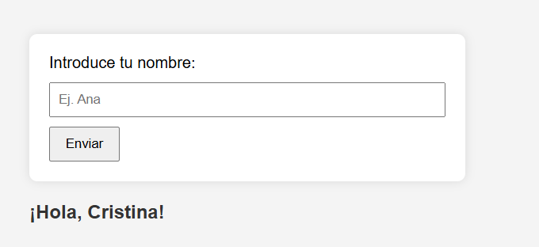
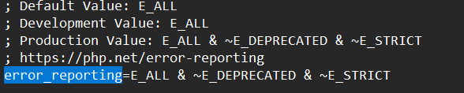
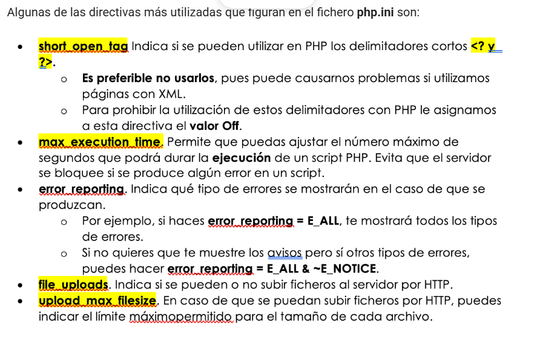

# UD1- ARQUITECTURA WEB

* [Enlace a Mi presentación](C:\xampp\htdocs\dwes\DWES_Cristina\README.md)

## Repositorio de :

* Cristina

## PHP

* Iniciando PHP
* Hemos ejecutado los primeros scripts de php
* phpinfo daba la información
* si se llama index.php se ejecuta por completo
* Documentacion PHP

---

## PHP.INI

Mostramos la mayoria de errores que vienen por defecto

