# UD2- PHP

* Saltos de linea en consola usando "\n"

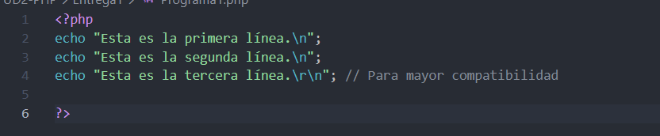

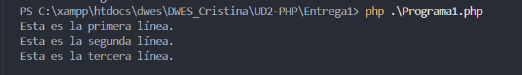

* Usamos "br" nos hara un salto de linea

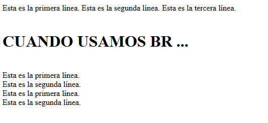

* Usamos "nl2br" para convertir las "\n" en saltos de linea como las "br".

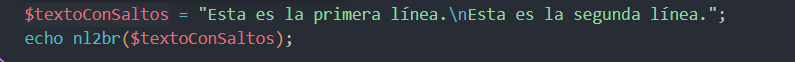

## Tipos de datos

* Variables en PHP

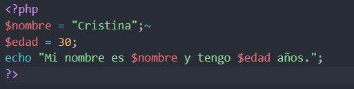

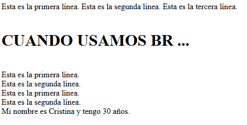

* Ambito de las variables

  * Global: las variables definidas fuera de la funcion seran desconocidad¡s dentro de estas a menos que les pongamos "global" cuando las llamemos DENTRO.

  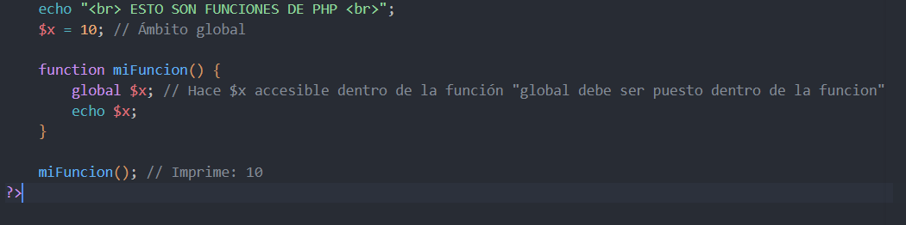

  * Local solo existen dentro de la funcion
  * Estaticas

  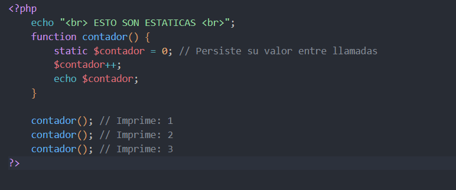

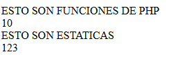

## Básico 2: Lenguaje PHP

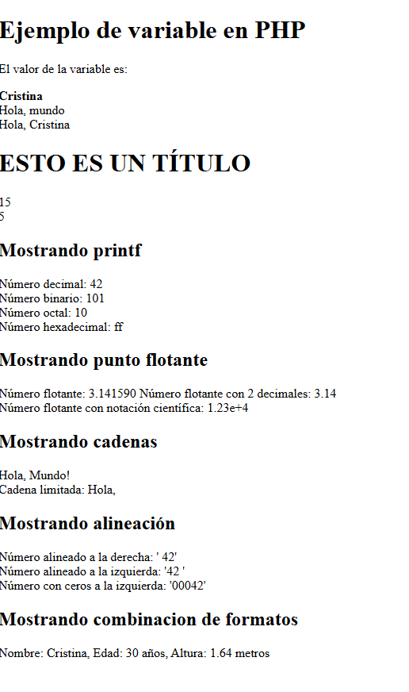

## Especificadores (IA comprobada)

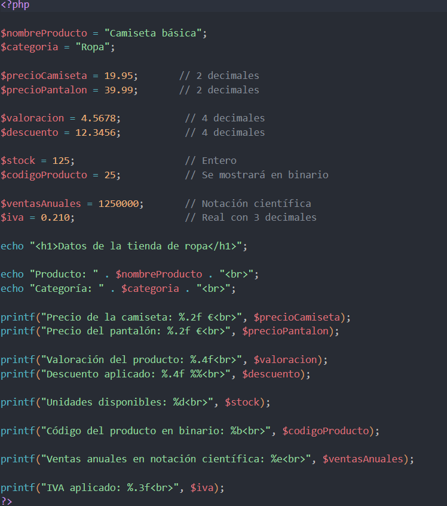

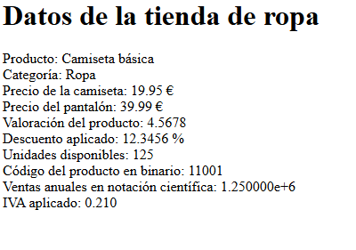

### Programa 4

* Especificadores  con el comando printf.

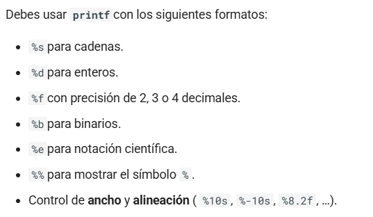

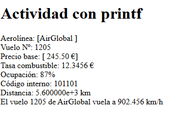

* Sprintf

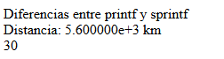

La diferencia entre printf y sprintf es que imprime directamente perdiendose el valor, mientras que en sprintf devuelve la cadena formateada que luego puedes guardar en una variable, concatenar o mostrar con echo.

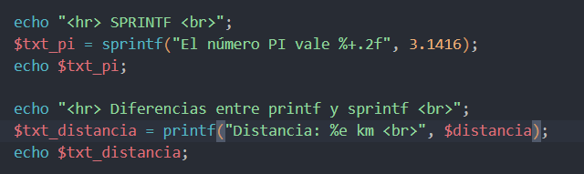

* Cadenas de texto

Puede especificarse entre comillas simples, dobles, heredoc y nowdoc

Con las comillas simples no se realizaran sustituciones:

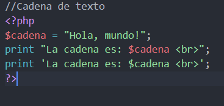

### Programa 5 (Cadenas)

* Unicode

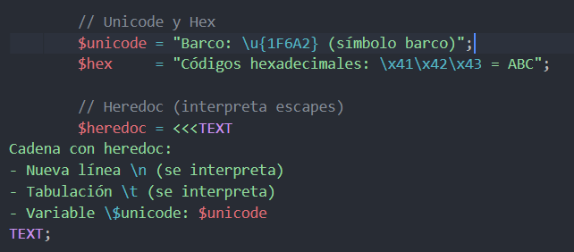

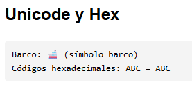

* Secuencias de escape útiles

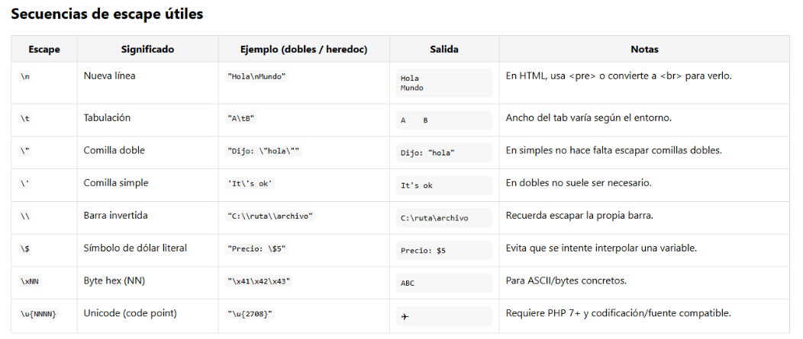

## Datos y funciones

* gettype()
* settype()
* isset ()
* unset()

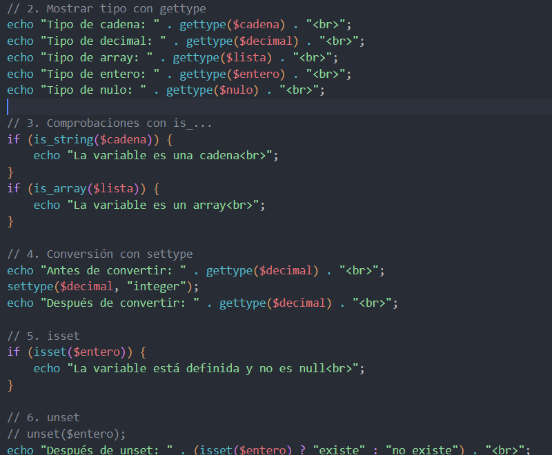

### Evitar errores

* **error_reporting**(**0**);

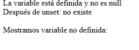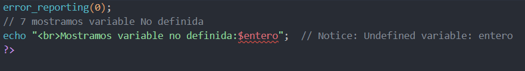

## Constantes y constantes predefinidas

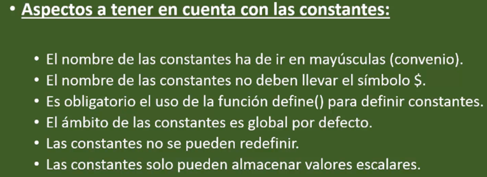

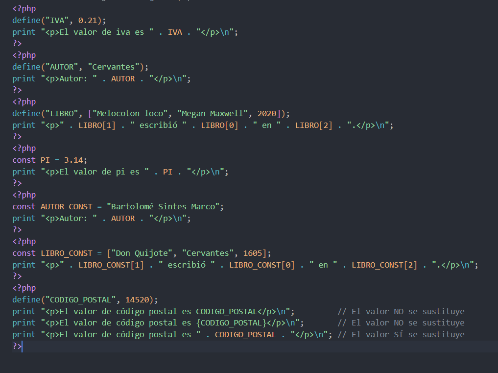

### Predefinidas

<pre>Array
(
    [E_ERROR] => 1
    [E_RECOVERABLE_ERROR] => 4096
    [E_WARNING] => 2
    [E_PARSE] => 4
    [E_NOTICE] => 8
    [E_STRICT] => 2048
    ...
)
</pre>

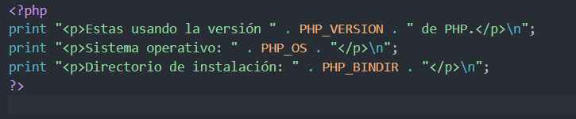

### Programa 8

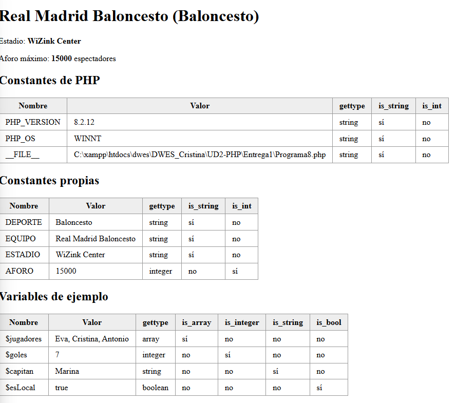

## Fechas y horas

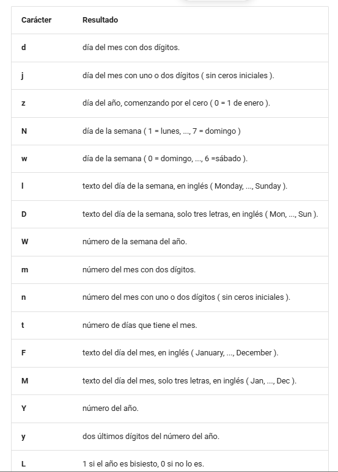

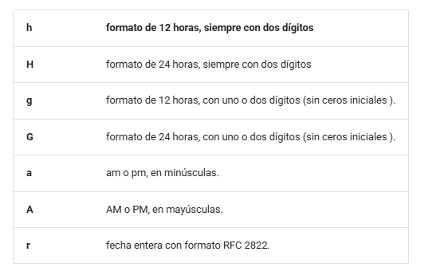

### Programa 9

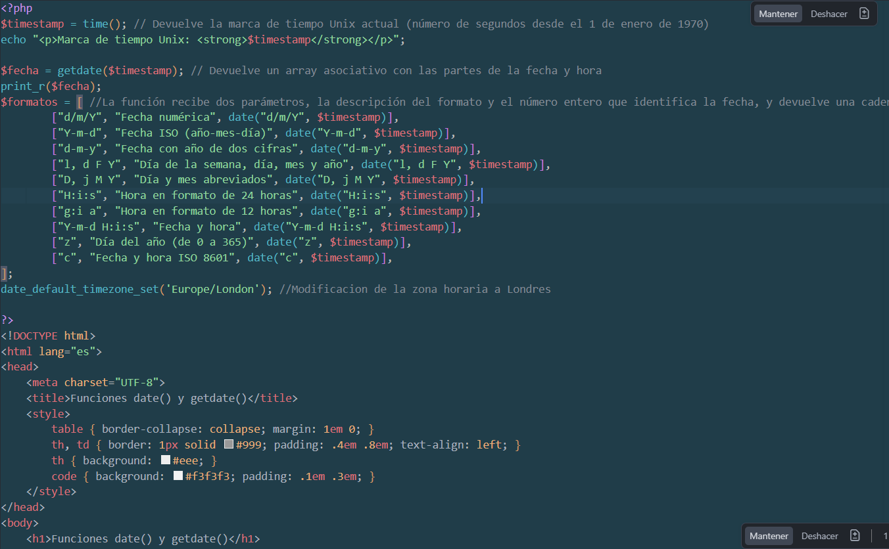

## Variables Especiales de PHP (superglobals)

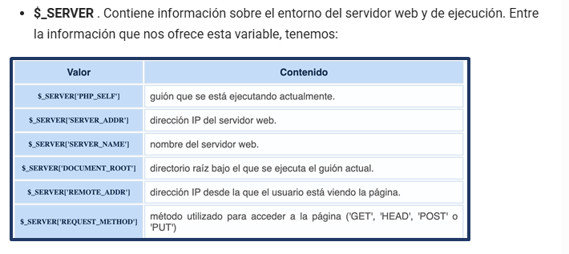

### Programa 10

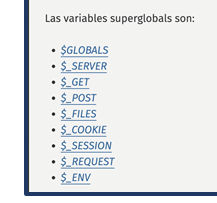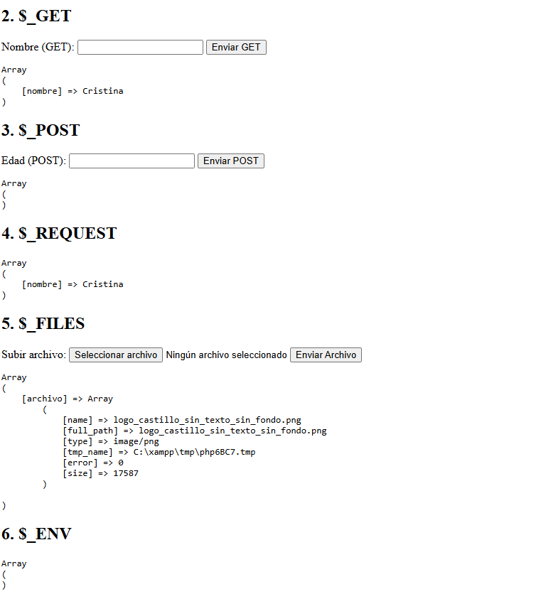
