# UD2 - S4 Control

## Extructura de control

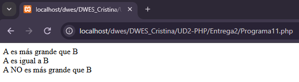

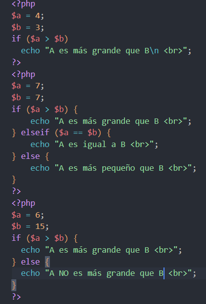

### Programa 12

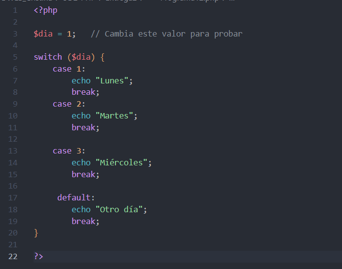

### Programa13

Match: evaluacion basada en el control de indentidad de un valor (Compara con varias alternativas como el switch).

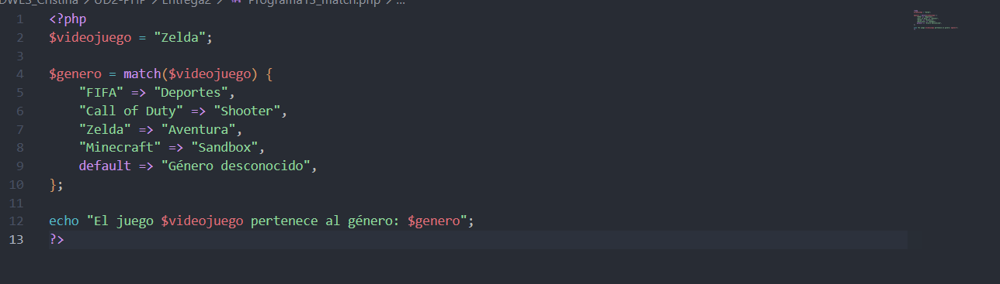

## Bucles

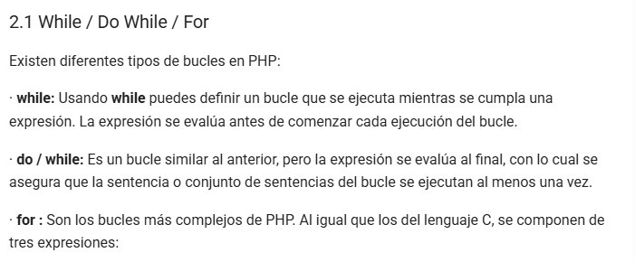

### Programa 14

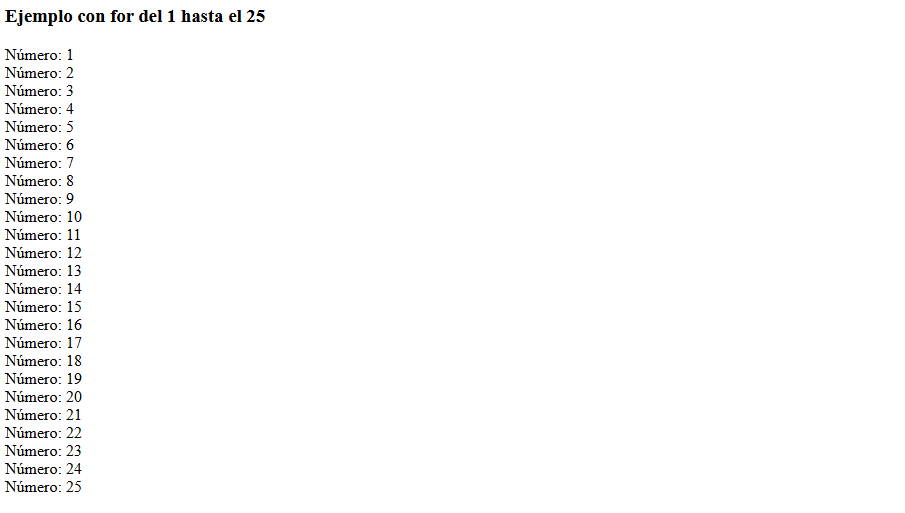

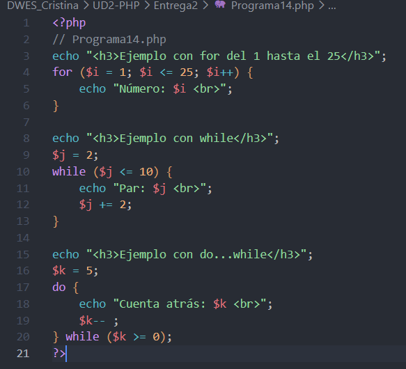

### Foreach

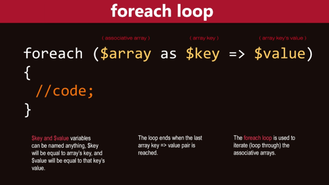

### Programa 15 (Observacion)

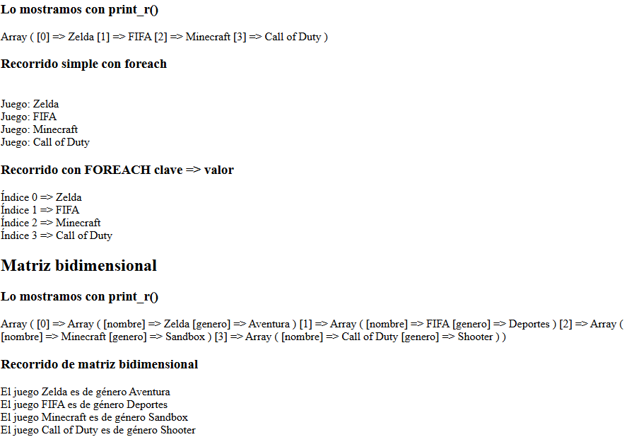

## Funciones

Las funciones simples si pueden ser llamadas antes de realizar la funcion, pero las condicionales no.

```php
<?php
// Función simple sin argumentos
function precioConIVA(): float {
    $precio = 399;  // definido dentro de la función
    $iva = 21;      // definido dentro de la función
    $precioFinal = $precio + ($precio * $iva / 100);
    return round($precioFinal, 2);
}

// Ejemplo de uso
echo "Precio con IVA: " . precioConIVA() . " €<br>"; // Llamada a la función y muestra del resultado
?>
```

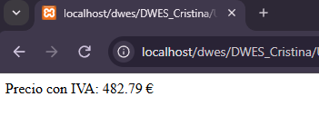

### Funciones condicionales

### Programa 16

```php
print "<h2>Funciones Condicionales</h2>";
// Función con condicional
$condicionalFuncion = true;
$precio = 10;

print("<br />Llamada antes de condicional: No puede hacerse<br>");   
if ($condicionalFuncion) {
    function precio_con_iva_condi() {
        global $precio;
        $precioiva = $precio * 1.21;
        print "El precio con IVA es " . $precioiva;
    }
}

print "<br />Llamada después de condicional<br>";

precio_con_iva_condi();   // Aquí ya no da error
?>
```

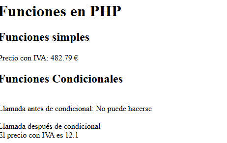

## Argumentos

* Siempre es mejor utilizar **argumentos o parámetros** al hacer la llamada.
* Además, en lugar de mostrar el resultado en pantalla o guardar el resultado en una variable global, las funciones pueden devolver un valor usando la sentencia **return** .
* Cuando en una función se encuentra una sentencia **return** , termina su procesamiento y **devuelve** el valor que se indica.

### Programa 17

La opcion 2 muestra la forma de hacer un **argumento por defecto**

* Puede haber valores por defecto definidos para varios argumentos, pero en la lista de argumentos de la función todos ellos deben estar a la **derecha** de cualquier otro argumento sin valor por defecto.

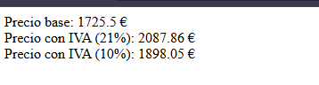

```php
<?php
function precioConIVA(float $precio, float $iva): float { // Función que calcula el precio con IVA con argumentos
//Opcion 2: function precioConIVA(float $precio, float $iva = 21): float {  
    // $precio → precio base
    // $iva    → porcentaje de IVA (por defecto 21%)
    $precioFinal = $precio + ($precio * $iva / 100);
    return round($precioFinal, 2); // Redondeamos a 2 decimales
}

// Ejemplo de uso
$precioBase = 1725.50;
echo "Precio base: $precioBase €<br>";
echo "Precio con IVA (21%): " . precioConIVA($precioBase, 21) . " €<br>";
//Opcion 2: echo "Precio con IVA (21%): " . precioConIVA($precioBase) . " €<br>";
echo "Precio con IVA (10%): " . precioConIVA($precioBase, 10) . " €<br>";
?>
```

### Argumentos por referencia

1. Si quieres que esto ocurra debes definir el parámetro para que su valor se pase **por referencia** , añadiendo el símbolo **&** antes de su nombre.
2. NO PONEMOS RETURN

```php
<?php
    print "<br/><br/>  ARGUMENTOS POR valor y por referencia <br  /> ";//ARGUMENTOS POR DEFECTO
    function precio_iva_referencia (&$precio /*le pasas su direcion de memoria 100325*/, $iva=0.15) {
        $precio *= (1 + $iva); 
    }

    $precio = 20;  //imagina que su MEMORY ADDRESS vale 100325
    print "<br/><br/>1- ANTES de llamar a la función:  El precio con IVA es ".$precio ;  //20

    precio_iva_referencia($precio);

    print "<br/>2- DESPUES de llamar a la función:  El precio con IVA es ". $precio ;  //23
    print "<br/><b>3- Anota en tus apuntes qué RETURN has usado</b>";
    print "<br/><b>4- No hemos usado ningun RETURN</b>"
?>
```

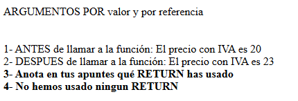

### Argumentos variables

* Existen **dos enfoques** : el moderno con `...$args` y el clásico con `func_get_args()`

```php
<?php
// Versión moderna (PHP 5.6+)
function sumarModern(...$numeros) {
    $suma = 0;
    foreach ($numeros as $n) {
        $suma += $n;
    }
    return $suma;
}

// Versión clásica (PHP <5.6)
function sumarClasico() {
    $args = func_get_args(); // obtiene todos los argumentos como array
    $suma = 0;
    foreach ($args as $n) {
        $suma += $n;
    }
    return $suma;
}

// Ejemplos de uso
echo "Suma moderna (7 + 9): " . sumarModern(7, 9) . "<br>";
echo "Suma moderna (4 + 52 + 75 + 46 + 5): " . sumarModern(4, 52, 75, 46, 5) . "<br>";

echo "Suma clásica (7 + 9): " . sumarClasico(7, 9) . "<br>";
echo "Suma clásica (4 + 52 + 75 + 46 + 5): " . sumarClasico(4, 52, 75, 46, 5) . "<br>";

?>
```

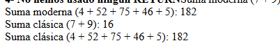

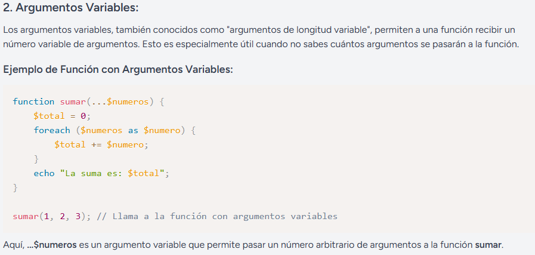

## Inclusion de ficheros externos

La diferencia clave entre `include` y `require` es:

* `include` → si el archivo no se encuentra, muestra **warning** y el script sigue.
* `require` → si el archivo no se encuentra, lanza **fatal error** y el script se detiene.

### Programa 19 (Carpeta)

* Ficheros 19A, 19B, 19C y 19D. Ademas de un fichero con las funciones

### Programa 20

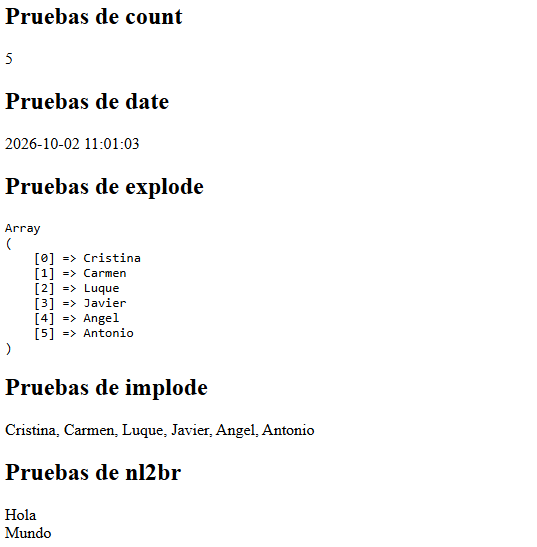

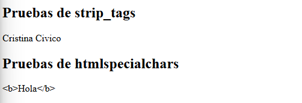

```php
<?php
echo "<h2>Pruebas de strip_tags</h2>";

$nombre = 'Cristina <b>Civico</b>';

$solo_texto = strip_tags($nombre); // strip_tags() elimina las etiquetas HTML y PHP de una cadena

echo $solo_texto;

?>
<?php

echo "<h2>Pruebas de htmlspecialchars</h2>";

$texto = '<b>Hola</b>';
echo htmlspecialchars($texto, ENT_QUOTES, 'UTF-8'); // htmlspecialchars() convierte caracteres especiales en entidades HTML para evitar la ejecución de código malicioso

?>
```

### Extensiones

* PIE (GitHub) [PIE_ENLACE](https://github.com/php/pie)

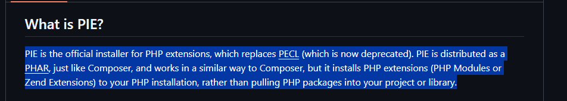

## Arrays

#### Programa 21

```php
<?php
//Ejemplo Definición de array simple

$array1 = array(
    "comida" => "pizza",
    "pizza" => "comida",
);

echo $array1["comida"] . "<br>"; // muestra pizza

// a partir de PHP 5.4
$array2 = [
    "comida" => "pizza",
    "pizza" => "comida",
];
echo $array2["pizza"]; // muestra comida

//mostrar un valor de cada uno

?>
```

### Arrays Multidimensionales

#### Programa 22

```php
<?php
$ciclos = array( 
    "DAW" => array(     "PR"   => "Programación",    "BD"   => "Bases de datos",    "DWES" => "Desarrollo web en entorno servidor"),
    "DAM" => array(     "PR"   => "Programación",    "BD"   => "Bases de datos",    "SGE" => "Sistemas de gestión empresarial")
);

//Array creado paso a paso
$modulos1[0] = "Programación";
$modulos1[1] = "Bases de datos";
$modulos1[2] = "Desarrollo web en entorno servidor";

// Mostrar elementos de array numérico
echo "<h3>Array numérico</h3>";
for ($i = 0; $i < count($modulos1); $i++) {
    echo "Módulo $i: " . $modulos1[$i] . "<br>";
}

// Mostrar elementos de array asociativo
echo "<h3>Array asociativo</h3>";
foreach ($ciclos['DAW'] as $clave => $valor) { // Recorrer array asociativo, debes indicar la clave del array asociativo que quieres recorrer
    echo "Siglas $clave => $valor <br>";
}
// Mostrar elementos de array multidimensional
foreach ($ciclos as $ciclo => $modulos) {
    echo "Ciclo: $ciclo <br>";
    foreach ($modulos as $codigo => $nombre) {
        echo "Módulo: $codigo => $nombre <br>";
    }
}
?>
```

### Funciones para recorrer arrays

#### Progama 23

```php
<?php
// Definir el array con ciudades
$ciudades = array("Sevilla", "Granada", "Córdoba", "Málaga", "Cádiz");

/* Programa23: COPIA COLOCA LAS FUNCIONES DONDE CORRESPONDADN :
next($ciudades) 
reset($ciudades) 
prev($ciudades) 
end($ciudades)
current($ciudades)
key($ciudades) 
*/

// 1. "FUNCION ARRAY RESET O CURRENT" → primer elemento
echo "Primer elemento con : " . "FUNCION ARRAY RESET O CURRENT" .current($ciudades) . "<br>";
echo "Clave actual: " . key($ciudades) . "<br><br>";

// 2. "FUNCION ARRAY NEXT" → avanzar
echo "Siguiente Elemento con : " . "FUNCION ARRAY NEXT"  .next ($ciudades) . "<br>";
echo "Clave actual: " . key($ciudades) . "<br><br>";

// 3. "FUNCION ARRAY PREV" → retroceder
echo "Elemento con  : " . "FUNCION ARRAY PREV"  .prev ($ciudades) . "<br>";
echo "Clave actual: " . key($ciudades) . "<br><br>";

// 4. "FUNCION ARRAY END" → último elemento
echo "Último elemento con : " . "FUNCION ARRAY END"  .end($ciudades) . "<br>";
echo "Clave actual: " . key($ciudades) . "<br><br>";

// 5. next() después del último → fuera del array
$valor = next($ciudades);
if ($valor === false && key($ciudades) === null) {
    echo "El puntero está fuera del array (hemos pasado el final).<br>";
} else {
    echo "Elemento actual: $valor<br>";
}

//Vamos a forzar a forzar que se muestre
echo "Elemento con next() fuera del array: " . next($ciudades) . "<br>";
echo "Clave actual: " . key($ciudades) . "<br><br>";
?>
```

### Funciones de datos compuestos

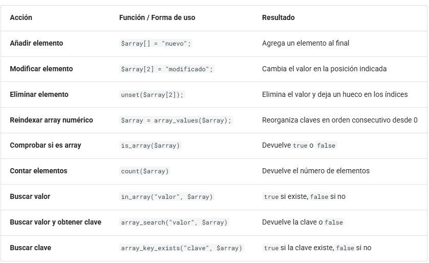

#### Programa 24

```php
<?php
$array = ["manzana", "pera", "uva"];

echo "<h1>Funciones para trabajar con arrays</h1>";

echo "<h2>Añadir elemento</h2>";
$array[] = "naranja";
echo "Se añade naranja al final: ";
print_r($array);

echo "<h2>Modificar elemento</h2>";
$array[2] = "uva modificada";
echo "Se modifica la posición 2: ";
print_r($array);

echo "<h2>Eliminar elemento</h2>";
unset($array[2]);
echo "Se elimina la posición 2: ";
print_r($array);
echo "El índice 2 ya no existe: " . (array_key_exists(2, $array) ? "sí" : "no") . "<br>";

echo "<h2>Reindexar array numérico</h2>";
$array = array_values($array);
echo "Después de array_values(): ";
print_r($array);
echo "El índice 2 existe ahora: " . (array_key_exists(2, $array) ? "sí" : "no") . "<br>";

echo "<h2>Comprobar si es un array</h2>";
echo "¿$array es un array? ";
echo is_array($array) ? "true<br>" : "false<br>";

echo "<h2>Contar elementos</h2>";
echo "Número de elementos: " . count($array) . "<br>";

echo "<h2>Buscar valor</h2>";
$valorBuscado = "pera";
echo "¿Está $valorBuscado en el array? ";
echo in_array($valorBuscado, $array, true) ? "true<br>" : "false<br>";

echo "<h2>Buscar valor y obtener su clave</h2>";
$claveEncontrada = array_search($valorBuscado, $array, true);
if ($claveEncontrada !== false) {
	echo "La clave de $valorBuscado es $claveEncontrada.<br>";
} else {
	echo "El valor $valorBuscado no está en el array.<br>";
}

echo "<h2>Buscar clave</h2>";
$claveBuscada = 1;
echo "¿Existe la clave $claveBuscada? ";
echo array_key_exists($claveBuscada, $array) ? "true<br>" : "false<br>";
?>
```

## pFormularios

### Programa 25

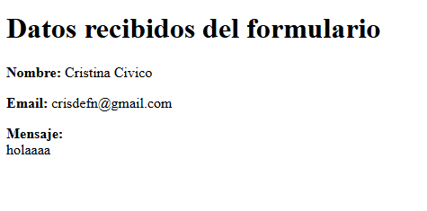
