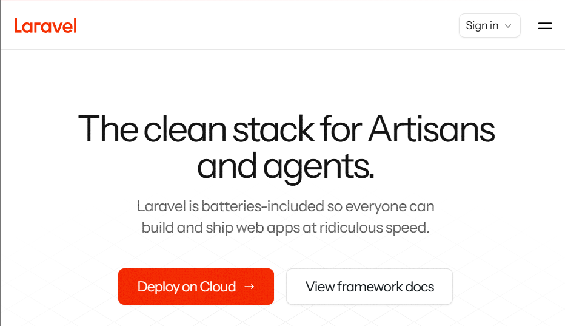
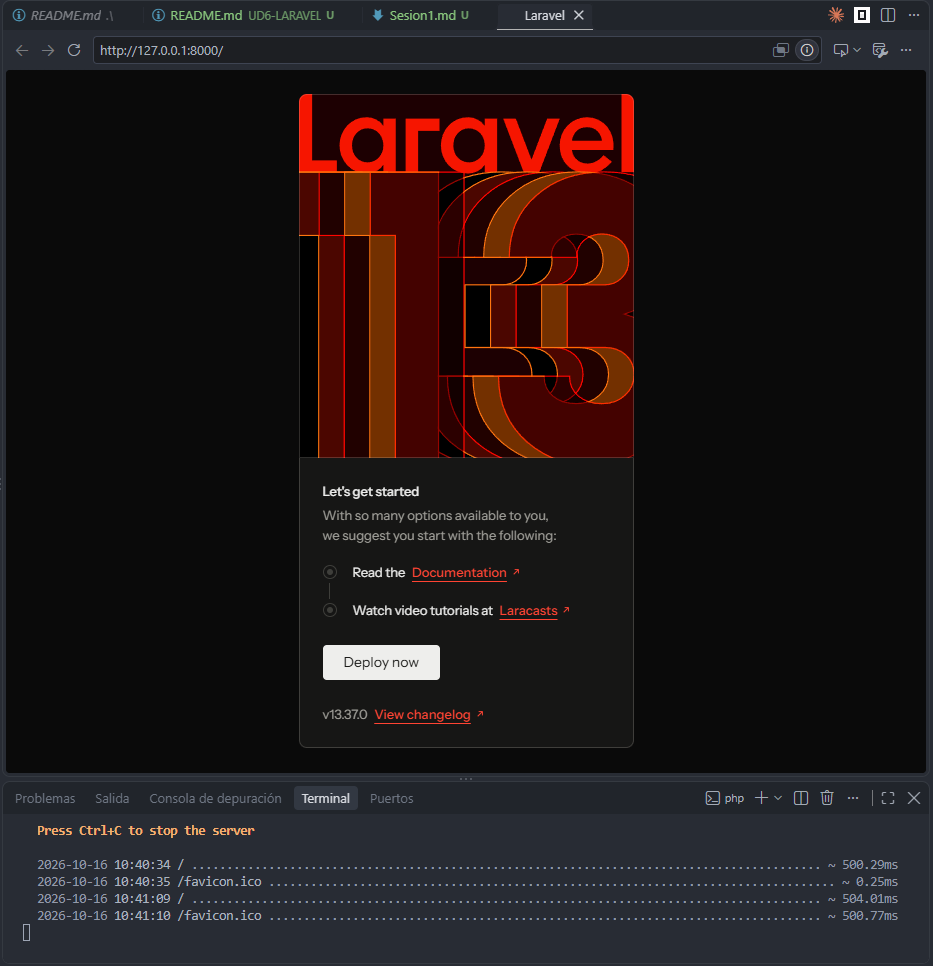
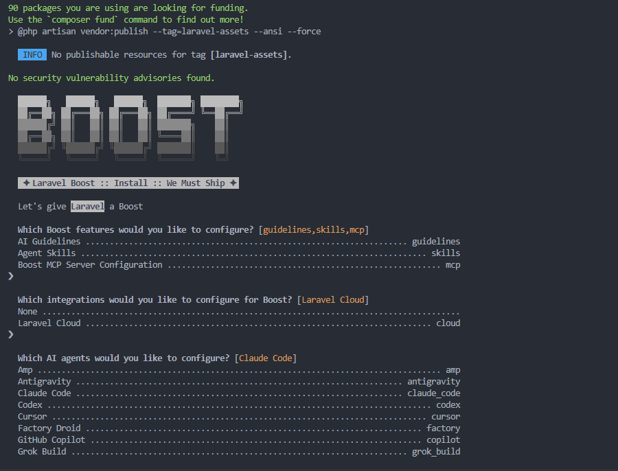
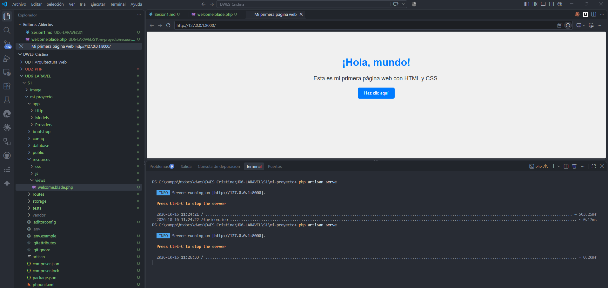

# Introduccion

## ¿Alternativas a laravel?

**Symfony:** Es la alternativa directa más profesional. Laravel utiliza muchos componentes por debajo de Symfony. Es ideal para proyectos grandes, complejos o de larga duración que exigen máxima modularidad y control estricto de la arquitectura.

### Historia

Laravel es un framework de código abierto para PHP creado por Taylor Otwell y lanzado oficialmente en junio de 2011. Inspiración: Se inspiró en frameworks de otros lenguajes como Ruby on Rails, Sinatra y ASP.NET MVC para lograr una sintaxis expresiva y limpia. Se introdujo **Eloquent ORM** (para interactuar con las bases de datos mediante objetos).

[Pagina oficial](https://laravel.com/)



### Instalacion y ejecucion de Laravel

* [X] instalarás y configurarás un entorno de desarrollo para Laravel,
* [X] crearás tu primer proyecto y
* [X] documentarás todo el proceso mediante  **evidencias** .



### Composer

Composer nos ayuda a crear un un proyecto de forma automatica solamente nos pregunta yes/no para tomar decisiones.



Comprobacion del entorno

- Sistema operativo: Windows 11
- PHP: 8.5.11
- Entorno utilizado: ZTS Visual C++ 2022 x64
- Git: 2.51.1.windows.1

### Vista principal

Cambiamos el archivo welcome.blade.php y vemos como lavista de nuestra pagina cambia.

```php
<!DOCTYPE html>
<html lang="es">
<head>
    <meta charset="UTF-8">
    <meta name="viewport" content="width=device-width, initial-scale=1.0">
    <title>Mi primera página web</title>

    <style>
        body {
            font-family: Arial, sans-serif;
            background-color: #f0f0f0;
            text-align: center;
            padding: 50px;
        }

        h1 {
            color: #007bff;
        }

        p {
            color: #333;
            font-size: 18px;
        }

        button {
            background-color: #007bff;
            color: white;
            border: none;
            padding: 10px 20px;
            border-radius: 5px;
            cursor: pointer;
        }

        button:hover {
            background-color: #0056b3;
        }
    </style>
</head>
<body>

    <h1>¡Hola, mundo!</h1>
    <p>Esta es mi primera página web con HTML y CSS.</p>
    <button>Haz clic aquí</button>

</body>
</html>
```


