# UD6 · Sesión 2 · Estructura, entorno y Artisan

# 2.1. EstructuraCarpetas

## Carpeta App

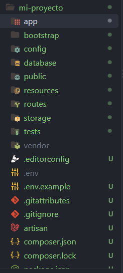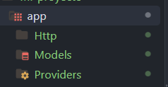

El modelo y el controlador se encuentran dentro de la carpeta app.

Creamos userController con el comando: php artisan make:controller UserController

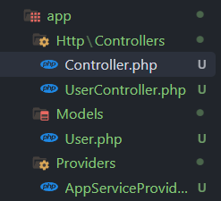

Despues encontramos los middleware que se encuentran en medio de un proceso y otro, es decir, procesan peticiones antes o despues de que llegue el controlador

Creamos el middleware --> php artisan make:middleware UserMiddleware

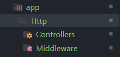

Resultado: Se crea UserMiddleware y este por defecto lleva una funcion para el manejo de este, mas adelante se explicara el contenido.

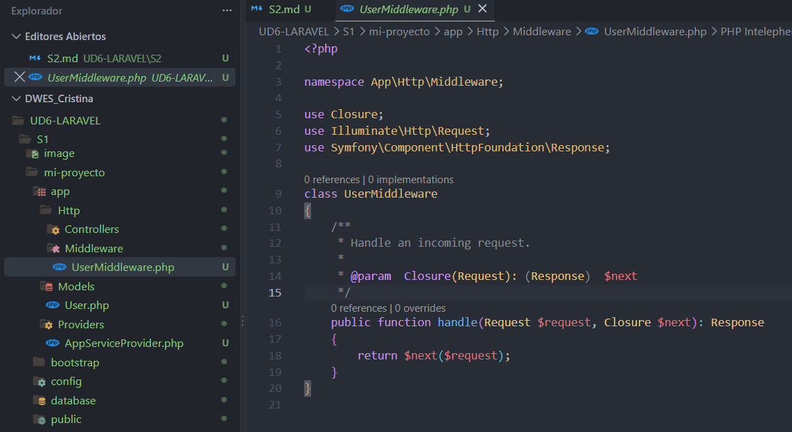

Creamos carpeta request -->php artisan make:request UserRequest

El request que se usa dentro del middle sirven para validar

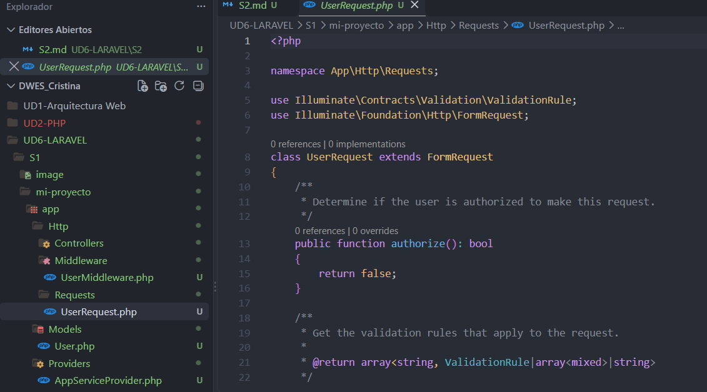

Carpeta model: contiene los modelos y **cada modelo representa una tabla de bases de datos**

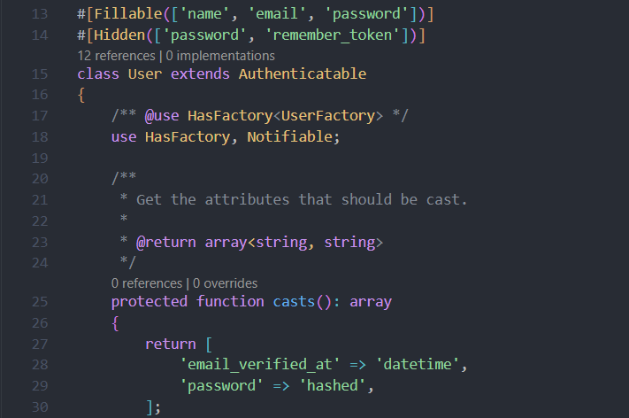

Providers se encargan de registrar servicios.

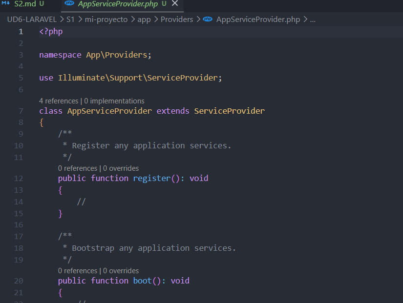

## Carpeta Route

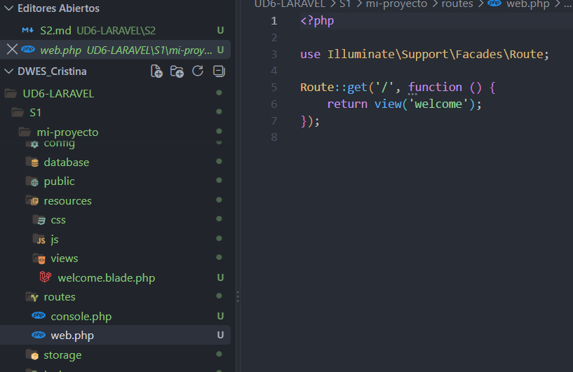

Creamos una nueva vista llamada hola.blade.php y dentro de welcome.php añadimos la ruta.

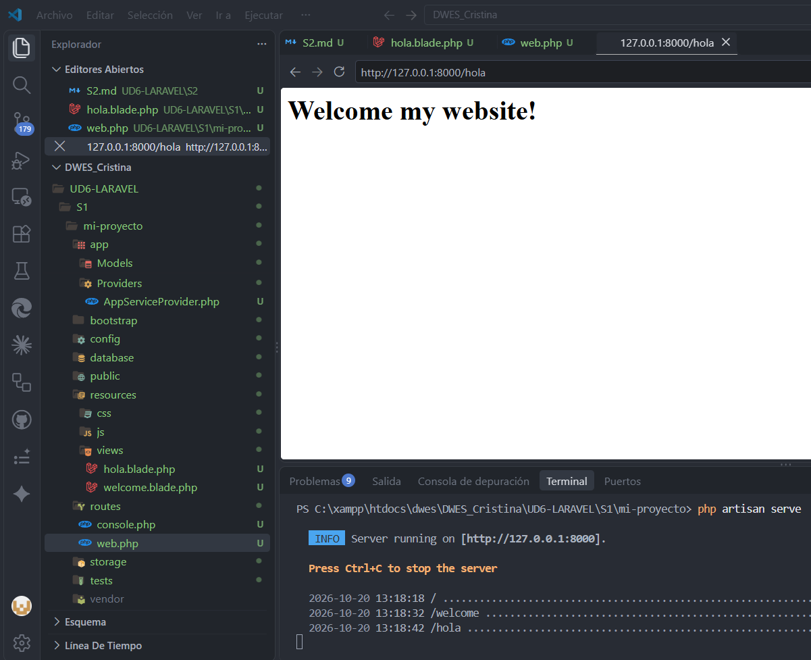

La API se instala de forma independiente y se vera en el tema siguiente

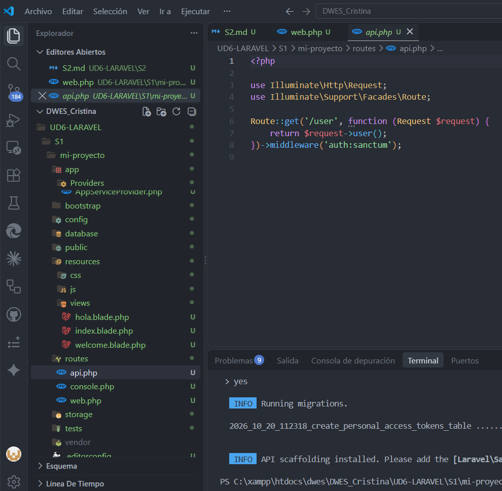

## Carpeta Resources

Una de las carpetas mas importantes de aqui es la carpeta vista

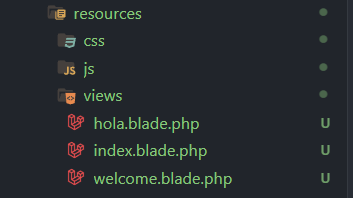

## Carpeta config

Son archivos de la aplicación, uno de los archivos mas importante dentro de esta carpeta es app.php donde podemos cambiar el nombre de la aplicacion.

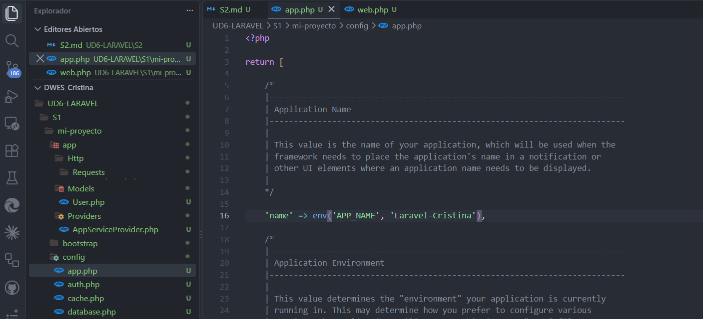

## Carpeta database

Las migraciones son el punto de partida.

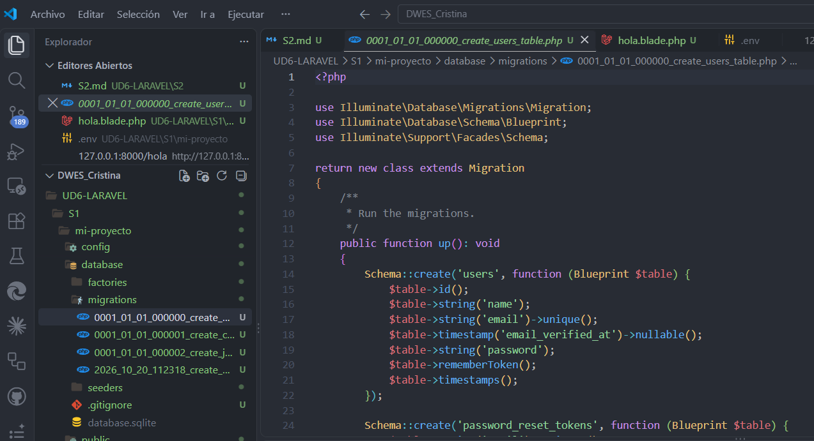

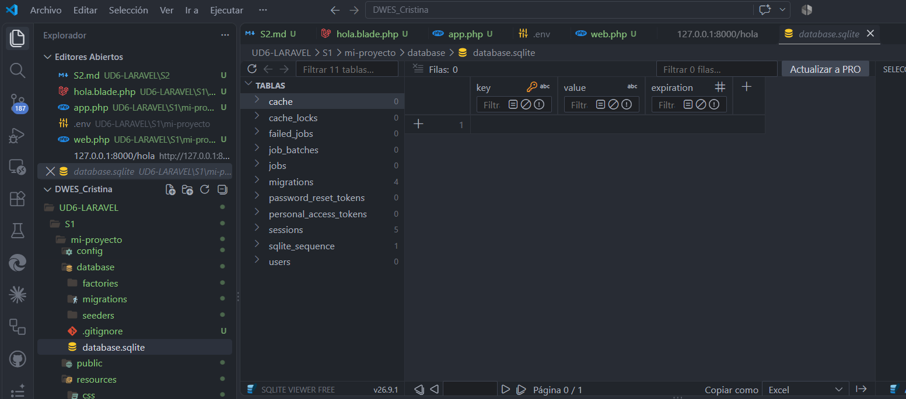

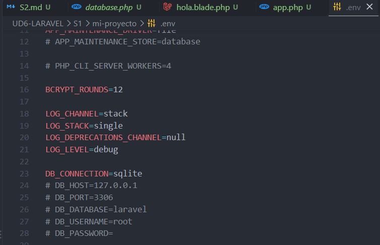

Los seeders pueblan la base de datos

## Carpeta public

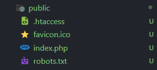

## Carpeta storage

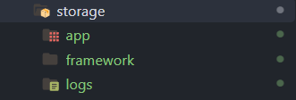

*Laravel.log

## Carpeta bootstrap

En el archivo app.php cambia las conversiones.

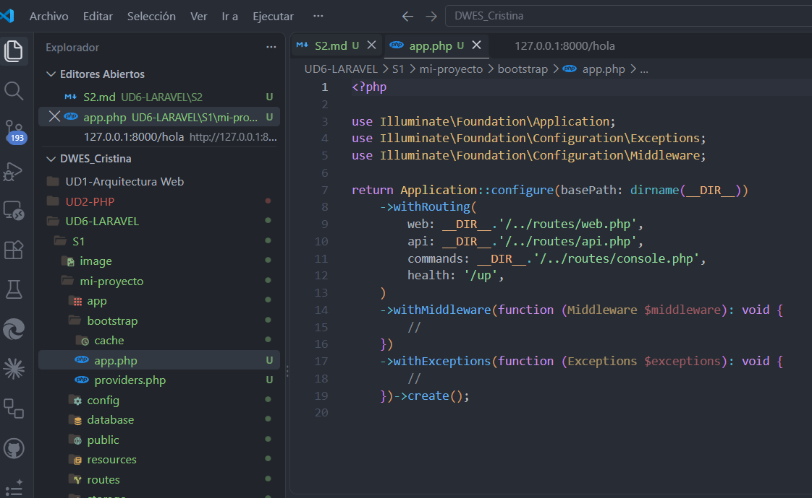

## Carpeta test

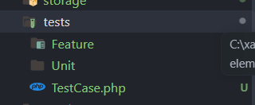

Ya eexisten ejemplos de test

```php
<?php

namespace Tests\Feature;

// use Illuminate\Foundation\Testing\RefreshDatabase;
use Tests\TestCase;

class ExampleTest extends TestCase
{
    /**
     * A basic test example.
     */
    public function test_the_application_returns_a_successful_response(): void
    {
        $response = $this->get('/');

        $response->assertStatus(200);
    }
}
```

Si marcamos una ruta que no existe por ejemplo no pasara el test.

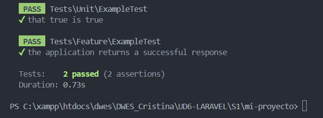

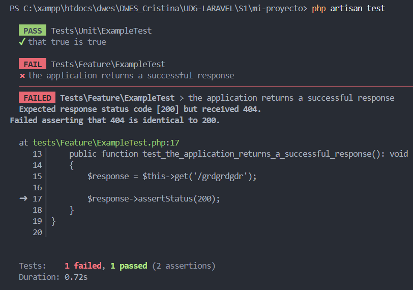

## Carpeta vendor

Nunca se modifican archivos ni se sube al GIT

# Practica

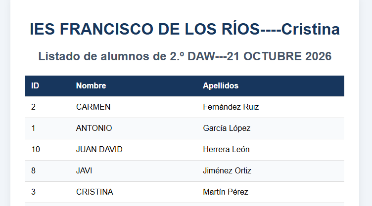

Modificamos el seeder con nuesto nombre real

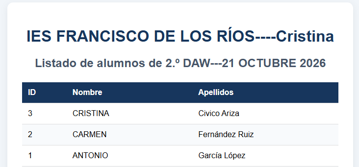

si modificamos el controlador de alumnos podemos ordenar la lista por ID

# 2.2. El archivo env

# 2.3 Artisan CLI
