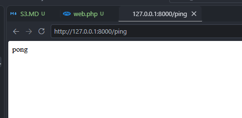
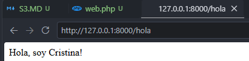
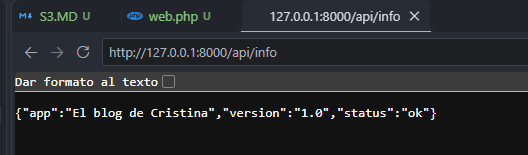
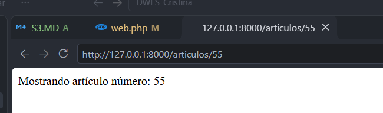
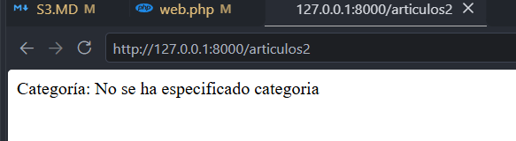
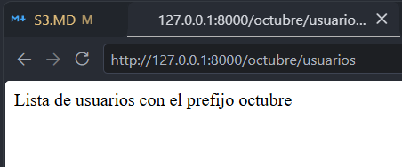
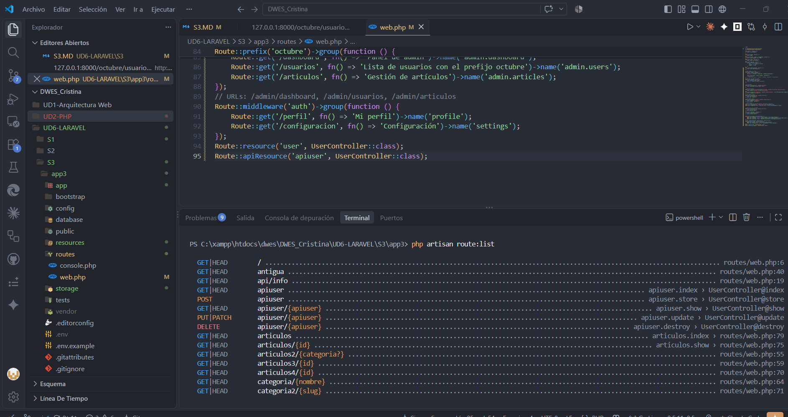

# Rutas y Vista

## Responder con texto plano

```php
<?php

use Illuminate\Support\Facades\Route;

Route::get('/', function () {
    return view('welcome');
});

Route::any('/ping', function () {
    return 'pong';
});
```





## Responder con una vista Blade


```php
// Redirigir con código de estado
Route::get('/antigua', function () {
    return redirect('/hola', 301);
    //301 es el codigo de estados permanentes.
});
```

## Parametros





## Rutas por prefijo



## Rutas de recursos



*Diferencia entre el resource y apiresource IMPORTANTE EXAMEN
