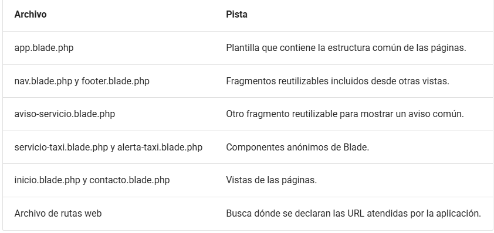
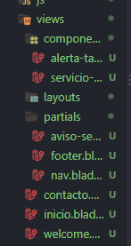

# Taxi Fernán Núñez

La página principal presenta los servicios disponibles y un formulario permite enviar una solicitud de reserva. Restricciones de la práctica: no hay controladores ni base de datos. Todas las peticiones se resuelven con funciones anónimas en routes/web.php.

## Instrucciones de arranque

1. Usamos composer para crear el proyecto:  "composer create-project laravel/laravel taxi-reservas"
2. Creamos la estructura de las carpetas y archivos que necesita

## Archivos creados y completados

1. Página de inicio
2. Formulario de reserva
3. Confirmación de la solicitud

## Cómo se conectan rutas, vistas, layout, parciales y componentes

## Comprobaciones realizadas
