# Seseion 5

Creamos un nuevo proyecto y dentro del punto .env cambiamos DB_CONNECTION, este apartado sirve para configurar nuestra BBDD.

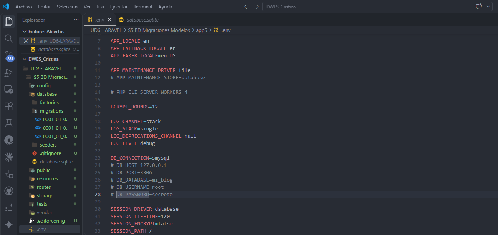

## Migraciones

Una migracion contiene dos metodos up() y down().

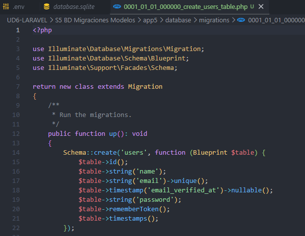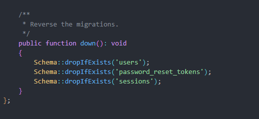

Laravel lleva un registro de las migraciones que se han ejecutado.

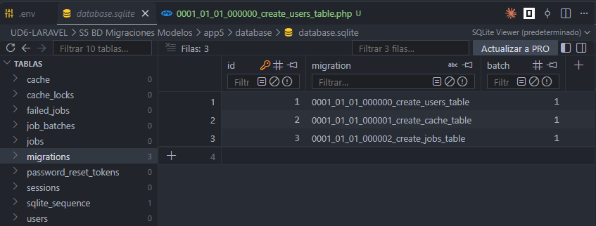

## Modificar tablas existentes

* php artisan make:migration add_(nombre tabla)

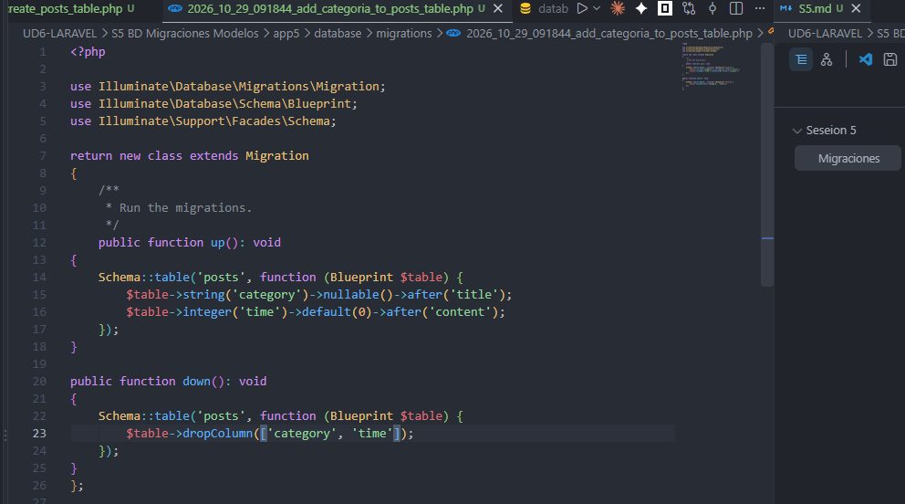

## Cambiar el tipo de columna

## Renombrar y eleminar columnas

## Modelos

Podemos crear modelos usando el comando:

'php artisan make:model Estacion'

Opciones que se pueden añadir (-m migraciones, -f genera una factoria o -s que crea un seeder)

## Asignación masiva y `$fillable`

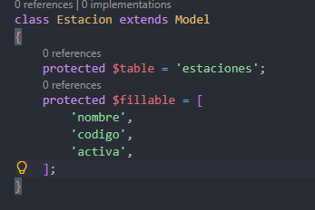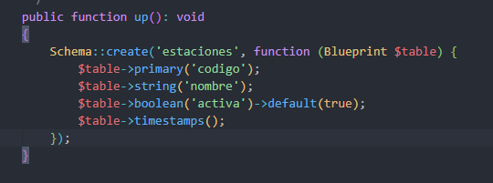

La alternativa `$guarded` define campos protegidos.

## Relaciones entre modelos

Una clave foránea relaciona registros en la base de datos.

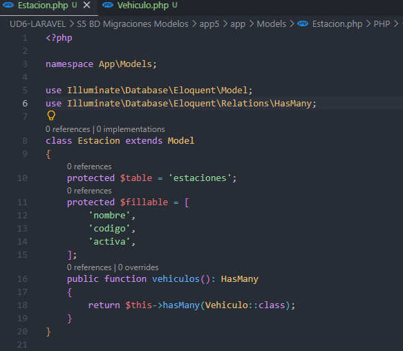

Las funciones de relacion estaran dentro del modelo, esta funcion nos dara una clase vehiculo.

### Relación inversa: `belongsTo`

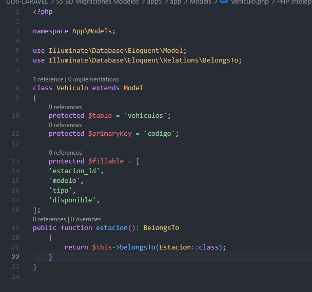

`belongsTo()` indica que la tabla actual (`vehiculos`) contiene la clave foránea que apunta al modelo relacionado (`Estacion`).

## Proyecto autoevaluable.

Hemos creado la migracion --> Requiere revision para ello usamos primero el comando 'php artisan make:migration add_requiere_revision_to_vehiculos_table'

Actualizamos up() y down().


```php
public function up(): void
    {
        Schema::table('vehiculos', function (Blueprint $table) {
            $table->boolean('requiere_revision')->default(false);
        });
    }

    /**
     * Reverse the migrations.
     */
    public function down(): void
    {
        Schema::table('vehiculos', function (Blueprint $table) {
            $table->dropColumn('requiere_revision');
        });
    }
```

Actualizamos el $fillable de vehiculo.

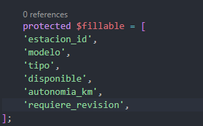

Usamos tinker para crear los nuevos datos que queremos guardar para que luego los mostremos en la vista.

Por ultimo, cambiamos la vista para poder ver los cambios.

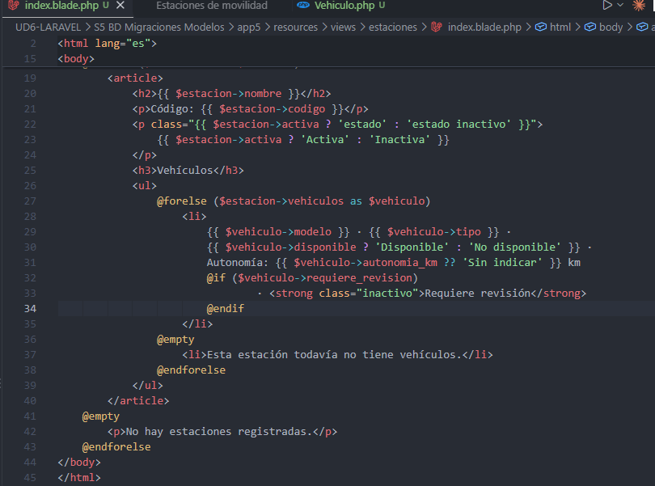

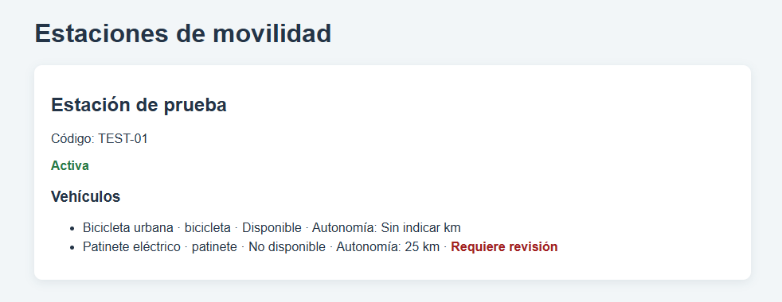
