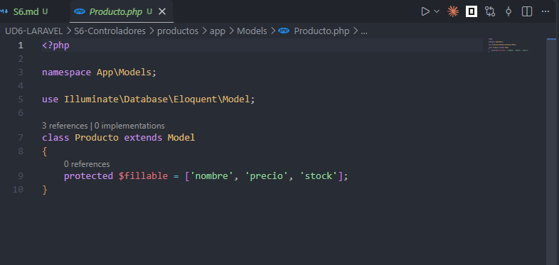
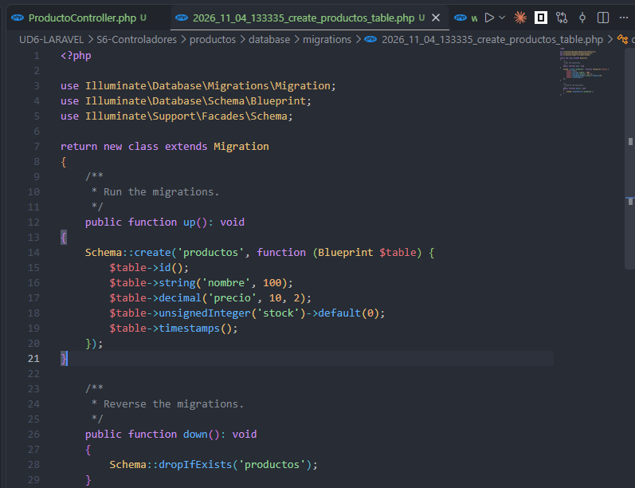
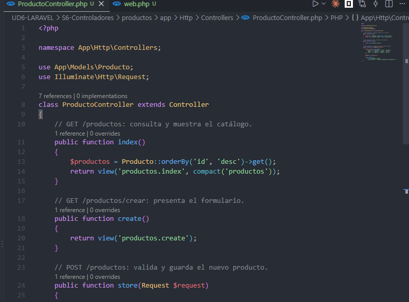
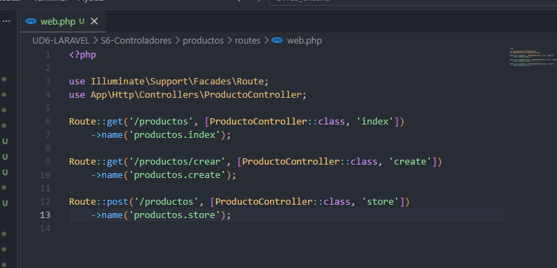
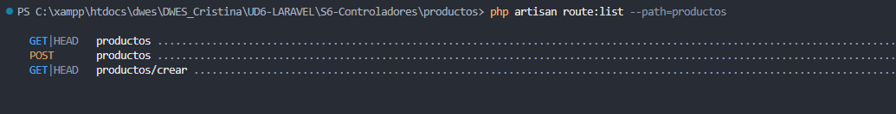
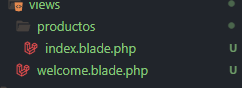
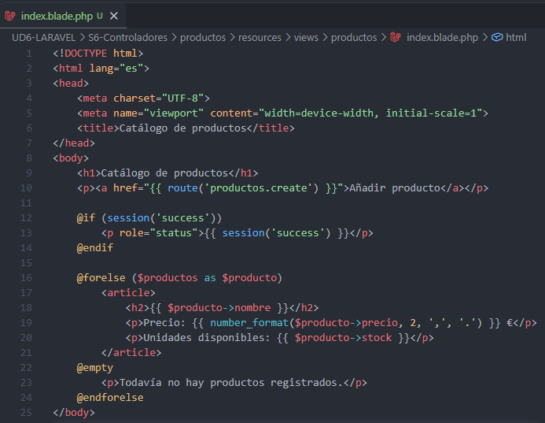
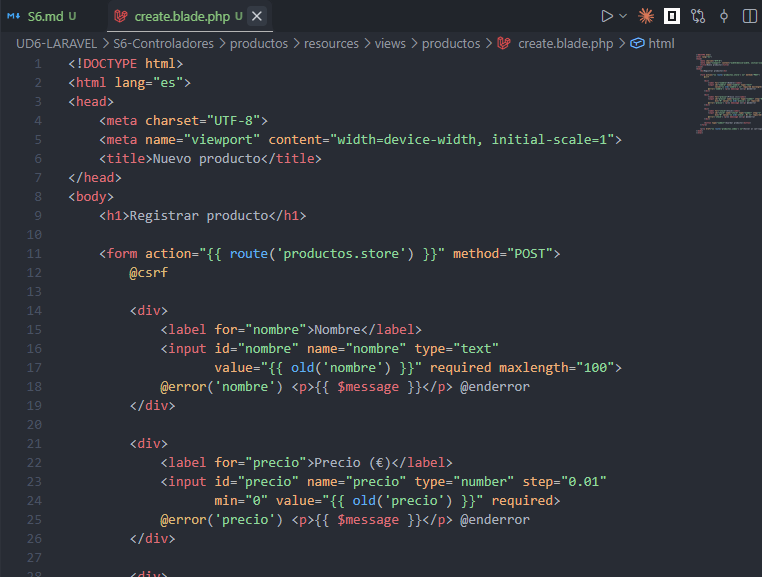
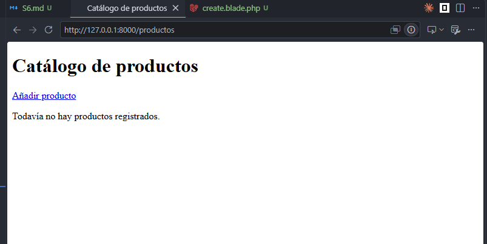
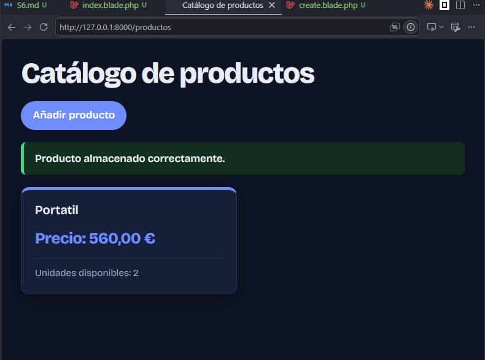

# Sesión 6

**Flujo:** navegador → ruta → controlador → modelo → base de datos → vista/respuesta.

## Creamos el modelo

## Generamos Migramos

## Creamos el controlador 

Creamos un controlador donde se agrupe toda la logica relacionada en vez de escribirla dentro de las rutas como haciamos antes. 

En este caso hemos escrito dos metodos uno para mostrar los productos y otro para mostrar los detalles de cada uno de estos.

## Registramos las rutas

Las rutas de esta forma quedan mas limpias.

Comprobaremos el registro de estas

## Creamos las vistas

## Creamos la vista del formulario

## Arrancamos el producto

## Prueba con css

