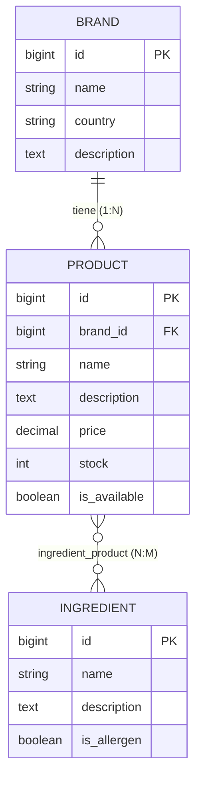
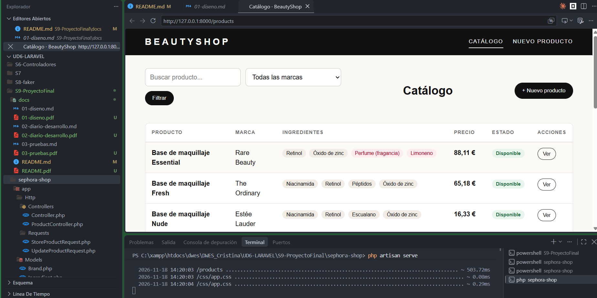
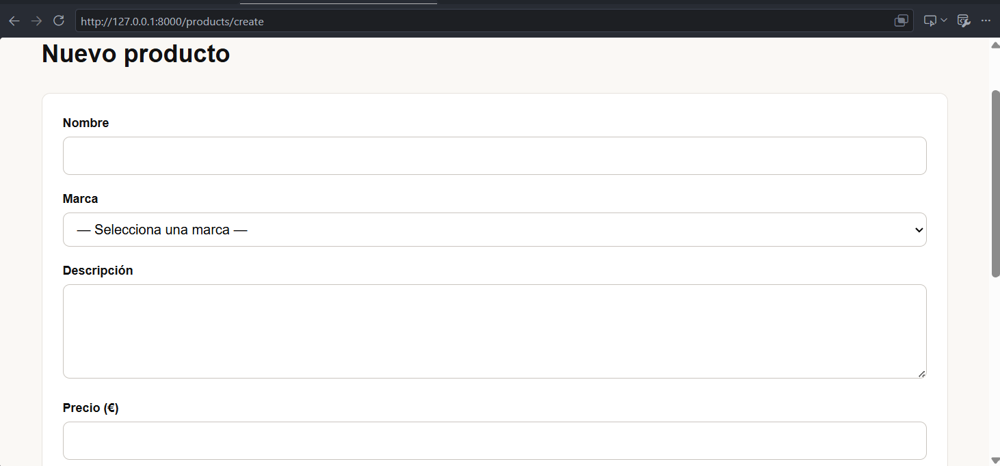
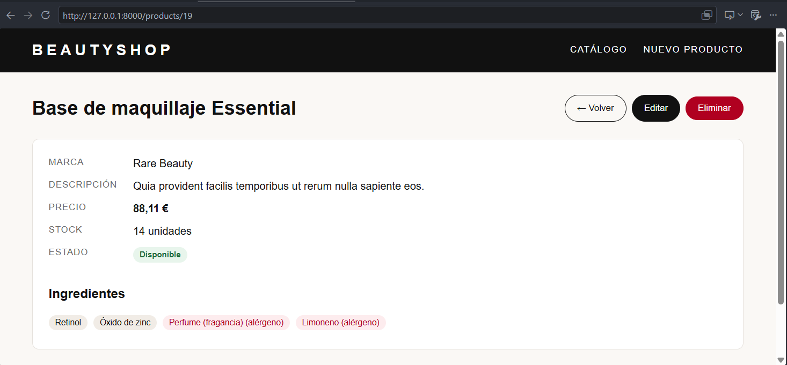
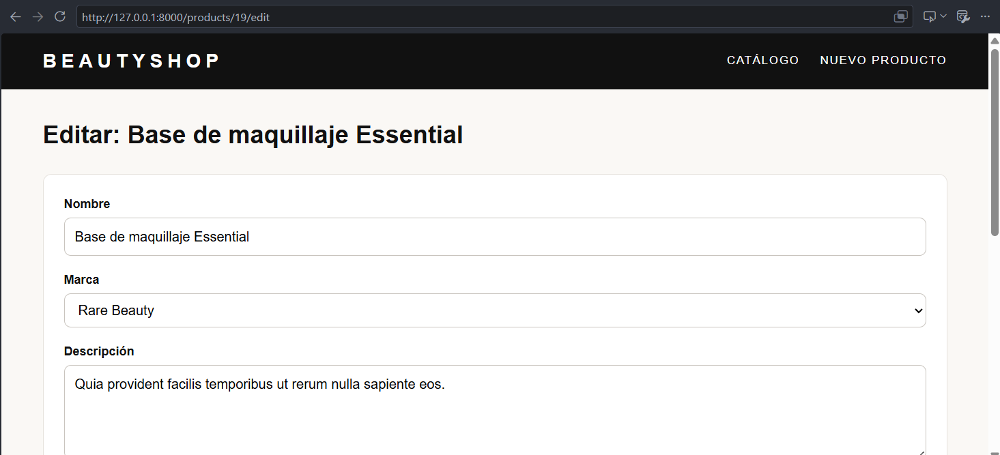
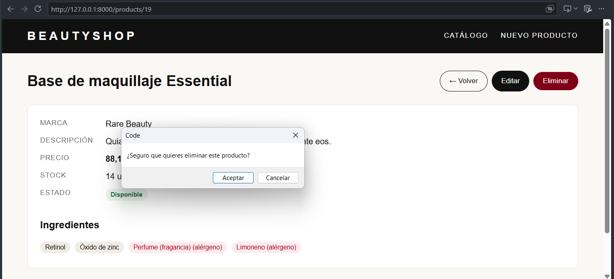
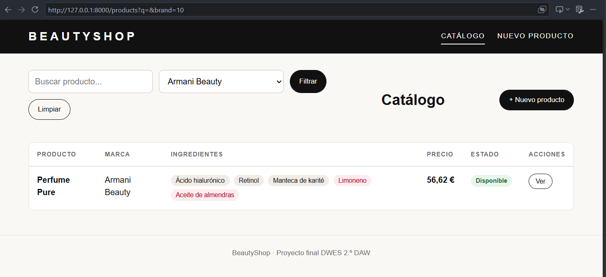

# 01 · Análisis y diseño (Versión 0)

## 1. Tienda elegida y problema que resuelve

**Tienda:** Cosmética (propuesta nº 9 del enunciado), con la temática de una perfumería/cosmética tipo Sephora. La aplicación se llama **BeautyShop** y no usa logos ni marcas registradas.

**Problema:** gestionar el catálogo de una tienda de cosmética: qué productos hay, de qué marca son, qué ingredientes llevan, a qué precio se venden y si están disponibles.

No se implementan pagos, carrito, autenticación ni pedidos (fuera del alcance del enunciado).

## 2. Modelos y campos

Los nombres de los modelos están en inglés; la interfaz está en español.

### `Brand` (marca)

| Campo       | Tipo       | Notas    |
| ----------- | ---------- | -------- |
| id          | bigint PK  |          |
| name        | string     | único   |
| country     | string(80) | nullable |
| description | text       | nullable |
| timestamps  |            |          |

### `Ingredient` (ingrediente)

| Campo       | Tipo      | Notas                 |
| ----------- | --------- | --------------------- |
| id          | bigint PK |                       |
| name        | string    | único                |
| description | text      | nullable              |
| is_allergen | boolean   | por defecto `false` |
| timestamps  |           |                       |

### `Product` (modelo principal)

| Campo        | Tipo                   | Notas                                |
| ------------ | ---------------------- | ------------------------------------ |
| id           | bigint PK              |                                      |
| brand_id     | bigint FK → brands.id | `restrictOnDelete`                 |
| name         | string                 |                                      |
| description  | text                   | nullable                             |
| price        | decimal(8,2)           | precio en euros                      |
| stock        | unsigned integer       | por defecto 0                        |
| is_available | boolean                | disponibilidad, por defecto `true` |
| timestamps   |                        |                                      |

### Tabla pivote `ingredient_product`

| Campo                       | Tipo                 | Notas                           |
| --------------------------- | -------------------- | ------------------------------- |
| product_id                  | FK → products.id    | `cascadeOnDelete`             |
| ingredient_id               | FK → ingredients.id | `cascadeOnDelete`             |
| (product_id, ingredient_id) | PK compuesta         | impide combinaciones duplicadas |

## 3. Diagrama

## 4. Relaciones

| Relación             | Tipo | Método Eloquent                                                           |
| --------------------- | ---- | -------------------------------------------------------------------------- |
| Brand → Product      | 1:N  | `Brand::products()` (`hasMany`) y `Product::brand()` (`belongsTo`) |
| Product ↔ Ingredient | N:M  | `belongsToMany` en ambos modelos                                         |

### ¿Por qué una relación necesita tabla pivote y la otra no?

- **Brand → Product (1:N) no necesita pivote.** Cada producto pertenece a una sola marca, así que basta una columna `brand_id` en `products` que apunta a la marca. La clave foránea vive en el lado «muchos».
- **Product ↔ Ingredient (N:M) sí necesita pivote.** Un producto lleva varios ingredientes y un ingrediente aparece en muchos productos. Ninguna de las dos tablas puede guardar una única clave foránea de la otra sin repetir filas o perder datos, por lo que se crea la tabla intermedia `ingredient_product`, con una fila por cada pareja producto-ingrediente.

## 5. Justificación del modelo de datos

- `Ingredient` describe la **composición** del producto, no un inventario de ingredientes (así lo indica la nota de diseño del enunciado).
- `is_allergen` permite destacar visualmente los ingredientes que pueden provocar alergias, algo relevante en cosmética.
- `is_available` y `stock` conviven: en la Factory y los Seeders, un producto sin stock queda como no disponible.
- `restrictOnDelete` en `brand_id` evita borrar una marca que tenga productos (integridad referencial).
- La clave primaria compuesta de la pivote garantiza que no se repita la misma combinación producto-ingrediente.
- Se usa el modelo principal `Product` con el CRUD completo; `Brand` e `Ingredient` se gestionan mediante Seeders (el CRUD de una segunda entidad es una ampliación voluntaria).

## 6. Las siete acciones del Resource Controller (`ProductController`)

| Acción | Método HTTP | URL                      | Nombre de ruta   | Función                                    |
| ------- | ------------ | ------------------------ | ---------------- | ------------------------------------------- |
| index   | GET          | /products                | products.index   | Listar (con buscador, filtro y paginación) |
| create  | GET          | /products/create         | products.create  | Formulario de alta                          |
| store   | POST         | /products                | products.store   | Guardar nuevo producto                      |
| show    | GET          | /products/{product}      | products.show    | Detalle                                     |
| edit    | GET          | /products/{product}/edit | products.edit    | Formulario de edición                      |
| update  | PUT/PATCH    | /products/{product}      | products.update  | Actualizar                                  |
| destroy | DELETE       | /products/{product}      | products.destroy | Eliminar                                    |

## 7. Decisión técnica: base de datos

El enunciado menciona MySQL o MariaDB. Se utiliza **SQLite** (valor por defecto de Laravel 13, sin necesidad de servidor), con **autorización del profesor**. Las migraciones, claves foráneas y relaciones funcionan igual.

## 8. Vista

### Vista - Catálogo

### Vista - Nuevo producto

### Vista - Producto (Ver)

### Vista - Editar

### Funcion Eliminar

### Filtro de búsqueda

